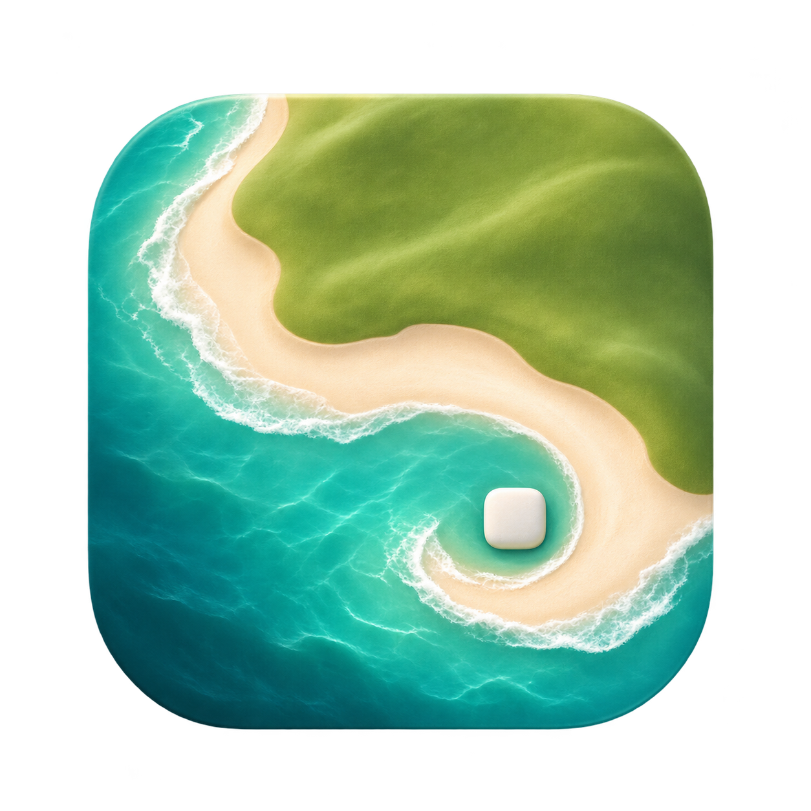

# 岸屿 Shoreline



适用于 macOS 的自适应动态壁纸。沙滩与草地会根据 Finder 桌面图标的位置调整地形，让图标融入风景。

Shoreline 是基于 Deskland Preview 独立维护的 macOS 移植修改版。沙滩、草地的渲染器、角色和主题素材来自原项目，macOS 窗口管理、Finder 图标读取、设置界面与系统集成在本仓库实现。感谢 Deskland 作者创作并开源这些主题。[Deskland 原项目](https://github.com/BLEZZ0102/Deskland)

## 下载与安装

下载 Universal DMG，支持 Apple Silicon 和 Intel Mac，运行需要 macOS 13 或更高版本。[版本下载](https://github.com/gengyj16/Shoreline/releases/latest)

发布包采用 **ad-hoc 签名，未经 Apple 公证**。首次启动需要按系统提示允许打开，并在“隐私与安全性 → 辅助功能”中授权 Shoreline，以读取桌面图标边界。详细步骤与常见问题见 [安装指南](docs/INSTALL.md)。

## 功能

- 沙滩与草地两个主题，支持调整参数、保存设置和更换场景种子。
- 根据桌面图标的增删与移动，平滑更新地形。
- 每个显示器独立渲染，支持 Retina 缩放与跨显示器坐标。
- 壁纸窗口位于 Finder 图标下方，桌面保持正常交互。
- 最高 30 fps，支持手动暂停，在屏幕休眠和切换用户时暂停。
- 可见窗口覆盖显示器可用区域时自动暂停该屏，桌面重新可见时恢复。
- 兼容点击壁纸展开桌面的操作，并考虑台前调度的窗口呈现状态。
- 暂停时停止动画帧调度，图标或参数变化时按需绘制静态画面。
- 中文设置界面与菜单栏控制，主题自带文案沿用上游资源。

## 权限与数据

辅助功能用于查询 Finder 桌面图标的位置与尺寸。主题收到的数据为矩形坐标。自动暂停通过系统窗口元数据和命中测试判断遮挡，资源由应用内的 `shoreline://themes/` 协议读取。

偏好设置存储在本机，应用 Bundle ID 为 `local.shoreline.wallpaper`。菜单栏“打开日志文件夹…”可访问 `~/Library/Logs/Shoreline/`。日志记录启动、主题加载、暂停恢复、显示配置变化、脚本错误与 WebKit 进程事件，约 1 MB 时轮换并保留一份旧日志。统一日志子系统为 `local.shoreline.wallpaper`。

反馈问题时，请提供应用版本、macOS 版本、显示器配置和相关日志片段，并检查日志中的本机信息。

## 从源码构建

需要完整安装并选中 Xcode 26 或更高版本，以编译 Icon Composer 图标资源。应用部署目标为 macOS 13。

```sh
./scripts/build.sh
open dist/Shoreline.app
```

命令行构建生成包含 `arm64` 和 `x86_64` 的 Universal App，并使用 ad-hoc 签名。也可以直接打开 `Shoreline.xcodeproj` 构建运行。Release 配置构建两种架构，Debug 使用当前机器架构。

本地生成 DMG 和 SHA-256 文件使用以下命令。

```sh
./scripts/release.sh --check
./scripts/release.sh
```

推送 `v版本号` 标签后，GitHub Actions 自动测试、构建和发布安装包、对应源码归档与校验文件。首次发布和重试步骤见 [发布指南](docs/RELEASING.md)。

## 测试

```sh
# 坐标、设置与桌面可见性单元测试
./scripts/test-native.sh -only-testing:ShorelineTests

# WebKit 双主题渲染、图标更新、暂停与恢复
./scripts/test.sh

# 原生设置界面及 Finder 连接测试
./scripts/test-native.sh

# 打包流程回归测试，使用模拟工具
python3 -m unittest discover -s Tests/Packaging -v
```

原生测试需要 macOS 14 或更高版本。UI 和 WebKit 渲染测试需要可用的图形桌面，Finder 连接测试需要辅助功能权限，缺少权限时跳过该项。原生测试会关闭正在运行的同 Bundle ID 应用，使用隔离的测试偏好设置。报告、截图与渲染快照位于 `.build/`。

GitHub Actions 在 Apple Silicon 与 Intel runner 上运行单元测试和打包流程测试。真实 Finder 交互、点击壁纸展开桌面及台前调度需要在实际桌面环境验证。

## 仓库结构

```text
.github/workflows/       持续集成与版本发布
Sources/                 Swift/AppKit/SwiftUI 宿主与系统集成
Resources/Themes/        上游主题代码、素材及原始署名
Resources/AppIcon/       自制图标原图、Icon Composer 配置与生成说明
Resources/Info.plist     应用信息
config/                  Xcode ad-hoc 签名配置
Tests/Unit/              XCTest 单元测试
Tests/UI/                XCUITest 界面与 Finder 连接测试
Tests/Packaging/         打包脚本回归测试
Tests/SmokeTests.swift   WebKit 集成测试
scripts/                 构建、图标编译、测试与 DMG 打包
docs/                    安装与发布指南
Shoreline.xcodeproj/     Xcode 工程与共享 Scheme
project.yml              XcodeGen 工程定义
```

`dist/` 保存构建产物，`.build/` 保存缓存与测试报告，均由 Git 忽略。修改工程定义后，使用 XcodeGen 运行 `xcodegen generate`。替换图标原图后，运行 `./scripts/build-icon.sh` 并重新构建应用。

## 已知限制

- 当前适配 Finder 桌面图标，桌面小组件、堆叠和隐藏图标状态仍需进一步验证。
- 自动暂停采用九点窗口命中检查，持续覆盖约 0.5 秒后暂停，检测到桌面可见时恢复。特殊窗口形态可能影响判断。
- WebKit 为不同显示器分配渲染进程与图形资源。高分辨率、多显示器环境会增加内存占用，暂停时保留最后一帧和纹理。
- 已完成 Apple Silicon 原生和 Rosetta 下的双主题渲染验证，Intel 实机性能、各版本 macOS 和更多显示器组合仍需实测。
- ad-hoc 构建更新后，辅助功能权限可能需要重新添加应用。

## 来源与许可

项目采用 GNU GPL v3。Deskland 的代码、主题和素材保留原作者署名，上游名称用于来源说明。Shoreline 使用独立名称和自制图标。[完整许可](LICENSE) · [版权声明](NOTICE) · [来源及修改记录](THIRD_PARTY_NOTICES.md)

本仓库使用的上游基准为 `9818b577402ff476e1b59da07970c56472713126`。修改范围包括 macOS 宿主、WebKit 消息与资源桥接、暂停时的动画调度和静态重绘。Deskland 的名称与图标适用上游单独说明。[上游商标说明](https://github.com/BLEZZ0102/Deskland/blob/main/TRADEMARKS.md)
